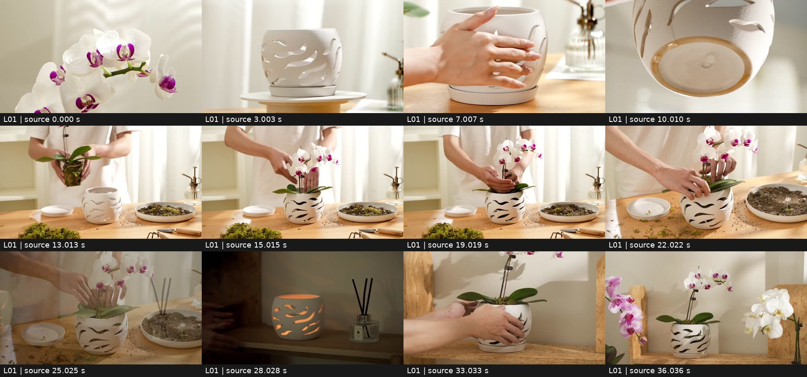
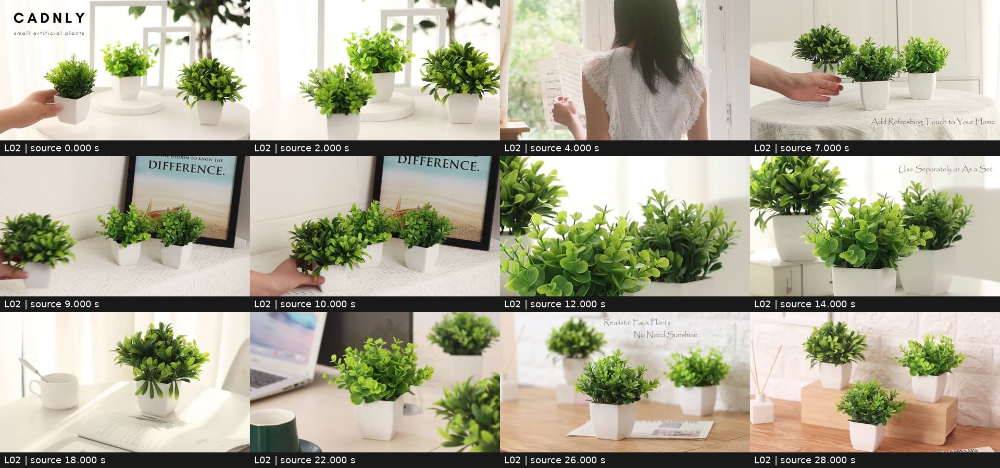

# 两条本地商品拍摄参考的学习记录

来源是用户于2026-10-28指定的两份本地MP4，按“同类拍摄风格参考”使用，非已核ASIN的竞品素材，也非Amazon官方拍摄规范。可复用方法见 [商品摄影与场景导演](../product-cinematography.md)。本记录及缩略图供研究复核，不进入商品身份上传包。

## 文件与查看范围

| ID | 仓库根目录源文件 | 可核媒体信息 | SHA-256 |
| --- | --- | --- | --- |
| L01 | `花盆产品视频_亚马逊主图视频拍摄.mp4` | 40.52秒，1280×720，16:9，约29.97fps，含AAC音轨 | `99eaa056bdbdc0dd635c01c9b3fb35143534e2765094bd18c7eabe3df76c5413` |
| L02 | `52_静物-亚马逊跨境电商-视频拍摄-绿植道具.mp4` | 29.93秒，1280×720，16:9，30fps，含AAC音轨 | `ee1b9dd7ef61c8d5d99a3468e8aceee72a311ce329d12e462e16a361c1eead10` |

实际查看覆盖首尾的约1fps全片总览，共71个采样时点；另对12个三秒窗口按4fps加密查看，共144帧。基础解码每15个原始视频帧取一帧，共141帧，原始PTS保留在本次研究输出。加密窗口：L01的3–6、6.5–9.5、13–16、24–27、32–35秒；L02的0–3、5.5–8.5、9–12、12–15、18–21、22–25、25–28秒。

未连续播放，未听审音轨。以下时间段是便于复核的约略观察窗口，不是逐帧测得的剪辑点；加密帧可支持可见动作顺序、相对位移及叠化，不用于断言拍摄设备、精确速度、完整操作教程或声音节拍。音乐、旁白、环境声未核；未取得拍摄现场与灯位记录。

## L01：花盆片——先让设计可见，再给使用情境

| 观察窗口 | 实际可见内容 | 可迁移的表达方法 | 我方适配边界 |
| --- | --- | --- | --- |
| 约0–3s | 白色带紫色花心的兰花近景，背景有浅色纹理与明暗变化 | 用局部颜色/形态建立氛围 | 卖空盆时不沿用花朵独占开场，应先识别盆体 |
| 约3–6s | 镂空白盆和托盘放在圆形台座上，浅色帘幕、木台面，后方有玻璃喷壶；构图缓慢变化 | 单件主角、低干扰背景，利用盆壁明暗看设计 | 不能由画面断言具体材质、尺寸、透气或排水性能 |
| 约6.5–9.5s | 双手触碰盆壁，手掌沿外侧移动；随后切到盆底视角 | 用手的接触提供体积感，再切结构局部 | 触摸不证明防滑、耐磨或轻量；底面需我方清楚依据 |
| 约10–12s | 盆底局部与镂空边缘可见 | 一镜聚焦一个结构信息，不用大段文字解释 | 不借此补造我方孔位、釉面或托盘连接 |
| 约13–20s | 白衣人物上身/手部在桌前将带根团的兰花放进盆内，随后取旁边材料；托盘、土料盘与工具在台面 | 中景保留支撑、容器和动作路径，道具服务正在发生的事 | 不能从样片推我方栽植方式、介质、适配植物或工具随货 |
| 约21–24s | 换成更近且略俯的角度，手在盆口整理表面材料 | 全动作空间后再靠近关键接触，避免所有镜头同景别 | 手与盆口不可被浅景深/字幕遮住；操作仍需我方依据 |
| 约24–31s | 栽植画面叠化到较暗木架场景；镂空盆内部呈暖橙光，旁有扩香瓶；手撤出后继续展示盆体 | 不同光环境建立第二种装饰情境，完成态有停留 | 仅能观察到内透暖光，光源/耐热条件未知；不得直接迁移成烛台、加热或商品发光功能 |
| 约32–40s | 双手将有兰花的盆放到木架托盘上，松手退出；叠化到更宽的兰花组合，墙上有花影，末段变暗 | “放稳—退出—完整结果”形成收尾；宽景用环境建立记忆 | 更多兰花是画面布置，不能据此推套装；原片约40秒结构不应塞进15秒 |

观察所得：白/米色、浅木与少量紫色让盆壁和花朵突出；帘幕、玻璃小道具和侧向明暗构成生活空间。它同时采用相对固定的展示、手部动作和不同景别，氛围并非全靠推拉。以上为画面结果；柔光设备、实际窗光和精确灯位未核。

## L02：绿植片——用层次、摆放与用途变化建立生活感

| 观察窗口 | 实际可见内容 | 可迁移的表达方法 | 我方适配边界 |
| --- | --- | --- | --- |
| 约0–3s | 三种叶形的白盆绿植，高低前后错落；白色圆台和空画框作背景，左上有品牌文字；手放下一盆后退出 | 用手部小事件开场，台座与框线帮助分离轮廓，绿色对浅色背景 | 画面数量不是我方套装依据，不复制品牌/文字和叶形 |
| 约4–6s | 窗前背对镜头的人物看乐谱，旁有节拍器；随后叠化回盆栽 | 一小段生活情境建立安静感，叠化延续轻缓视觉 | 短商品片可把情境浓缩到商品可见的布景，避免脱离主角 |
| 约6–8s | 布桌面和书本上的组合，一只手取走前方盆栽后退出，旁有短英文文案 | 用“组合中取出”表达可分放；动作后留完整画面 | 分放与组合文案仅在我方售卖单元和用途成立时采用 |
| 约9–11s | 画框旁的布桌面；手放入一盆，松手退出，形成前低后高的组合 | 单一摆放动作；接触、落点和完成态可读 | 不由手/家具反推我方真实尺寸；不把书、画框归入随货 |
| 约12–17s | 先看有层次的叶面近景，再到台座/书本高低组合；上方留白放简短文案 | 细节与组合互相补充，白盆与叶团轮廓各自清楚 | 不将参考绿色、茂密度或文案变成我方商品事实 |
| 约18–21s | 单盆在书与杯子旁，窗边明暗形成条带；画面中商品、杯子及背景有缓慢相对位移 | 用阅读道具标记用途，小幅运动带出空间深度，商品保持静止 | 可提出缓慢横移；不能断言具体滑轨/焦距，也不让植株自己旋转 |
| 约22–25s | 电脑工作桌中，一盆为清晰主角，另有前后景盆栽和杯子；同样有缓慢构图位移 | 第二场景以办公补充阅读用途，前景局部/后景虚化衬托主角 | 单件方案不用重复盆栽制造数量暗示，可换为非售卖道具形成层次 |
| 约25–29s | 叠化至浅砖墙、木桌、书本/垫块的组合；最终是高低错落的完整陈列 | 统一白盆/绿色/浅背景，换场仍保持视觉家族，完整商品收束 | 背景额外盆栽不能自证套装范围；文案的仿真/养护主张需核我方商品类型 |

观察所得：层次来自台座高度、轮廓间隙、前后景与对焦，生活感来自书、杯、电脑与窗边光。原片多次换场与叠化不适合机械照搬到更短影片；文字能辅助，但主体摆放、分放和用途场景本身应可读。声音未听审，不能以乐谱/节拍器画面判断配乐类型。

## 迁移到技能的决定

| 来自哪条片 | 保留的手法 | 在我方分镜/总词中写什么 | 不直接迁移 |
| --- | --- | --- | --- |
| L01全貌与局部 | 从可识别商品切到有区别的结构，再回到完成态 | S01全貌；S02已知局部；尾镜商品与支撑完整 | 未知底面、孔位、材质与性能 |
| L01、L02手部镜 | 接触→移动→落稳→松手→退出 | 每个手部镜独立写相机、接触点与结束状态；没有依据就选纯展示 | 栽植/拆装/整形等未知动作；工具随货暗示 |
| L02高低组合 | 不对称三角、留缝、台座与背景框线 | 只按我方已确认数量排布；单件用布景高低与留白 | 三盆套装、额外商品和竞品叶形 |
| L01暖木、L02浅色窗边 | 色调克制，主光有方向，商品与背景分离 | 共用场景段写台面/背景、光向、阴影、颜色保护、道具用途 | 自动发光、过饱和绿、白盆过曝、只写风格形容词 |
| L02阅读/办公 | 每次换场补充一种使用情境 | 优先一个主场景，确有新用途再切第二场景；重复身份/尺度 | 为凑镜头换很多房间、无商品的人物插镜 |
| 两片收尾 | 商品完成态停稳、环境服务商品 | 尾镜保持主角清楚和完整，转场避开关键动作 | 把叠化当每镜必选，复制品牌/文案/音乐 |

上述为v1.7首次观察结论。v2.0已将适用手法整理为[两套内置三段模板](../builtin-video-templates.md)，采用三条各15秒、分镜确定后一次故事板生成的新流程。原片不是我方身份参考，也不能证明最终生成质量。

## v2.0复核：全片2fps、摄影结构与三段模板

本次在原文件上重新运行ffprobe和SHA-256核对，文件与上表一致。两片全片按2fps重新解码，共141个采样时点（L01 81、L02 60），分7张总览逐一目视检查，补充此前1fps和重点窗口观察。图上时间是fps采样名义时点，剪辑边界仅近似到采样间隔，不能当逐帧剪点；未连续播放/未听审音轨。仅确认存在AAC流，无法据此判断配乐、口播、节拍或拟音；模板声音是另行设计。

用户本次粘贴了两次同一绿植路径，依据项目中的实际两份MP4及此前记录，用L01花盆片与L02绿植片作为两份参考；不把重复路径计为第二个独立样本。

### L01复核：景别、动作与空间

| 名义时段 | 更具体的画面/变化 | 摄影与剪辑观察 | 转成我方模板的决定 |
| --- | --- | --- | --- |
| 0–2.5s | 兰花花朵占主要画幅，浅背景可见柔影 | 近景开场；花朵和背景相对位置缓慢变化，不能据此确定设备/焦距 | 若卖花可借色形开场；卖盆则换成可识别盆体全貌 |
| 3–6s | 白色镂空盆与托盘在圆台上，盆口/底部均可见；喷壶在右后侧 | 中近景，帘幕纵向纹理与木面形成不同层次，盆壁亮暗让镂空边缘显形 | 固定主场景，保留商品与接触影，图像身份必须来自自己的盆 |
| 6.5–9s | 手掌接触盆壁，指尖横向滑过，盆在台面 | 切到更近的手物关系；动作与支撑可见，背景喷壶延续空间 | 单一触碰事件，先有手与产品尺度依据；不能把触摸写成耐磨/防滑证明 |
| 9.5–11.5s | 仰看悬起的盆底，圆形底环与中央可见结构 | 新角度硬切，直接暴露前视图无法证明的底面 | 我方无底图就换已知细节，不照搬底环/孔位 |
| 12–16s | 白衣操作者从画面左侧拿起根团，向中间盆口移动并落入，随后整理位置 | 中景保留双手、整盆、桌面、托盘、介质盘和工具；动作先托住再下放 | 操作要求真实步骤；空盆/仿真品可替换成简单摆放，不能默认栽植 |
| 16.5–20s | 手伸向画面右侧介质盘，再把材料带回盆口 | 同景别延续动作与道具方向，材料状态随操作变化 | 固定道具位置与剩余状态；不用跳切掩盖未知操作 |
| 20.5–24s | 视点变高、更近，手在盆口调整表面 | 切近景突出接触点；桌面散落材料仍在 | 完整事件中只选择必要步骤，15秒不足不能压成不可信手速 |
| 24.5–25.5s | 栽植画面逐步叠化到暗木架，盆中出现暖光 | 清楚的换场/光环境变化；不属于同一连续空间 | 仅借动机明确的情境切换；不把未核光源/耐热性能写入我方词 |
| 25.5–31s | 手放稳暖光盆并退出，接着更近地展示 | 动作完成后仍保留商品观察时间；画面较暗但轮廓仍可辨 | 默认去掉内部发光，用实物颜色与环境侧光保持体积感 |
| 31.5–34s | 兰花盆从左进入，落在木架已有托盘上，双手退出 | 支撑与落点清楚，动作闭合；背景花影明显 | 用落稳后的完整姿态作为跨段接缝，比悬空动作更易衔接 |
| 34.5–40s | 叠化到更宽兰花组合，最终渐暗 | 结果画面较长停留，多盆装饰形成层次 | 模板只在C03收尾；按我方实际数量摆放，不自动复制兰花 |

**节奏特征**：前段约3秒级的全貌/局部切换，中段给完整操作更多时间，末段留结果停顿。模板拆成C01外观、C02一次可信事件、C03摆放结果；各15秒是重新编排，不能宣称原片就是3×15秒。默认固定同一暖木场景，去掉来源中未经我方验证的暗场发光与栽植；有相应事实再加。

### L02复核：层次、用途与切换

| 名义时段 | 更具体的画面/变化 | 摄影与剪辑观察 | 转成我方模板的决定 |
| --- | --- | --- | --- |
| 0–0.5s | 手从左侧把一盆放到前方，另两盆在后方，左上有来源品牌字 | 商品事件立即开始，盆体与台面接触可见 | 用自己的数量和品牌规则；单件可用书/台座做高低层次 |
| 1–3.5s | 三种叶形形成前低后高陈列，白圆台、空框与窗光分离轮廓 | 主体保持摆放，构图缓慢改变，宽窄轮廓有间隙 | 以图中我方叶形为准，不复制来源三种叶团或增密 |
| 4–6s | 窗前背影人物持乐谱，节拍器可见，随后叠化到盆栽 | 生活意境插镜暂时离开商品；声音未听，不能据此认定钢琴配乐 | 三段商品模板减少脱离主角的插镜，用书杯与光线表达用途 |
| 6.5–8s | 布桌上三盆，手取走前方一盆，后方两盆留在原位 | 单一取物动作，变化前后可读；下部有文案 | 真有多件/可分放才用该事件，单件不模仿“组合中取出” |
| 8.5–10.5s | 切至画框旁，手从左把盆带入前方，放稳后退出 | 取走→新位置摆放可形成用途关联；不是保持同场景的连续实拍证据 | 想跨场则写明确切镜与SC02；固定场景版本让动作在同一桌面完成 |
| 11–13s | 叶团近景，亮绿圆叶与深绿细长叶在景深内外分层 | 细节突出不同叶形，背景高亮但主体有暗部 | 我方只展示实拍可辨细节，不依据来源制造多叶种 |
| 13.5–17s | 回到窗前白桌，书本抬高一盆，三个白盆呈高低层次，上方有短文案 | 整体与细节交替，空间层次胜过大幅运动 | 同一场景母参考可复用不同取景；单件通过留白和道具层次替代三盆 |
| 17.5–21s | 单盆在打开的书旁/上方区域，左侧杯子，窗边形成明暗条带 | 缓慢相对位移形成视差，物品维持静态阅读情境 | T02主场景：商品静止、相机轻微横移，不让花盆自行转动 |
| 21.5–24.5s | 切到电脑桌，前景主盆清楚，电脑在左后，另有背景盆与杯子 | 第二用途有明确道具语义，取景持续小幅位移 | 仅选择多场景时启用办公角；不能无理由在每段重建房间 |
| 25–27s | 叠化到浅砖墙与木桌，主盆前景，其他盆在后方，文案涉及仿真/无需阳光 | 场景与文字共同表达定位 | 这种主张须我方商品类别支持；植物类型未确认就不引用 |
| 27.5–29.5s | 叠化到垫块上的高低陈列，扩香道具在侧，完整组合停留 | 同一白/绿/浅木视觉风格下完成收束 | C03完整结果；数量、品牌与香氛道具不成为随货暗示 |

**节奏特征**：若干约2–4秒的场景/景别单元，手部事件短而完整，细节与用途场景互补，叠化用于跨空间/结果。T02将此手法收敛为同一阅读角的三段连续推进；用户确需多用途才在段落边界引入办公场景。原片约30秒不是直接拉伸成45秒，应增加有信息的观察停留而非复制重复镜头。

### 可复核图像

下列是本次实际查看的2fps总览，供研究复核，不是生成故事板，不进入我方商品参考包：

- [L01 0–11.5秒](local-shooting-20261028/L01-dense-1.jpg)
- [L01 12–23.5秒](local-shooting-20261028/L01-dense-2.jpg)
- [L01 24–35.5秒](local-shooting-20261028/L01-dense-3.jpg)
- [L01 36–40秒](local-shooting-20261028/L01-dense-4.jpg)
- [L02 0–11.5秒](local-shooting-20261028/L02-dense-1.jpg)
- [L02 12–23.5秒](local-shooting-20261028/L02-dense-2.jpg)
- [L02 24–29.5秒](local-shooting-20261028/L02-dense-3.jpg)

实际光源、灯具、焦距、滑轨等设备未核；“侧光/柔光/缓慢相机运动”在模板中是为复现可见效果提出的拍摄指令，不是原现场设备结论。模板已提供可替换商品的摄影结构，最终依我方资料具体化；本轮没有生成我方商品视频或验证即梦账户。
