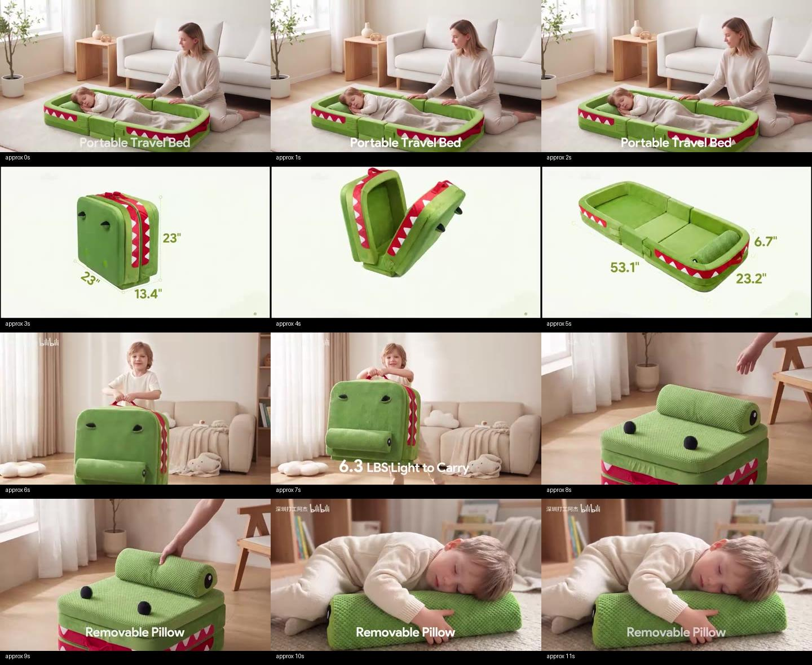
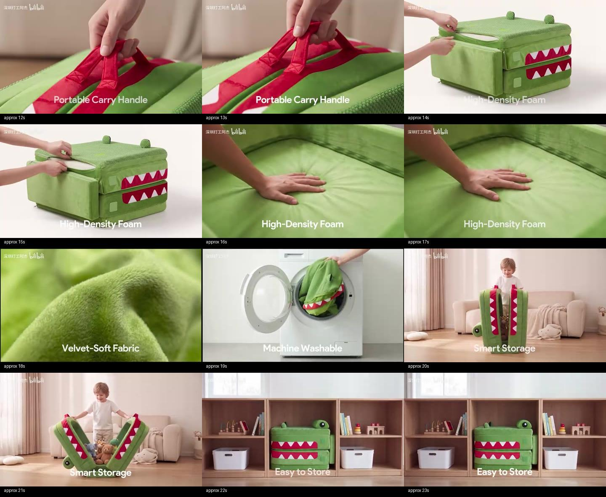
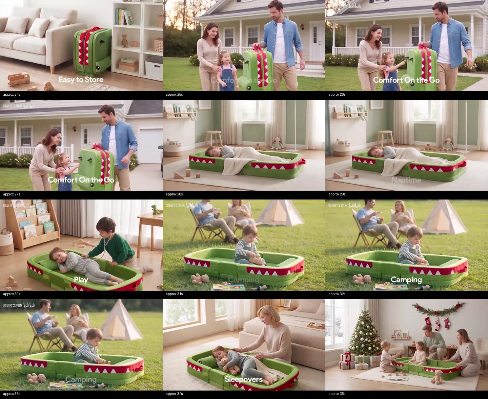
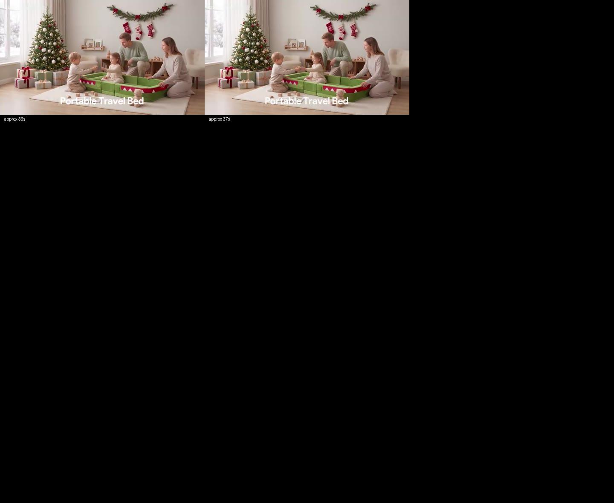

# 综合产品展示案例：BV1aGaq6rErq

来源：[用户指定B站视频](https://www.bilibili.com/video/BV1aGaq6rErq/)。2026-10-29经B站公开元数据与播放接口获取媒体。作者“深圳打工阿杰”；标题为“Seedance2.5制作的亚马逊儿童玩具主图视频,纯AI视频，无需实拍，”。画面主体为绿色鳄鱼造型的儿童折叠旅行床。标题是作者对制作方式的声明，不证明实际模型版本、生成设置、亚马逊投放或审核状态。

## 查看范围

页面工具无法打开，公开API可取。源元数据标1920×1080、38秒；本次获取的是640×360、25fps、约37.97秒的可访问版本，不称已看1080p。全片1fps采样38帧；另对2.5–6、8–12、14–18、19.5–22.5秒四个动作窗口按4fps采样，共58帧，合计96个图次。实际查看四张总览和四张加密图。非连续播放、非逐原始帧审查；未听审音轨，不能评价音乐节拍或旁白。标签是近似采样时间，非逐帧确定的切点。

[媒体与采样记录](bv1ag-20261029/metadata.json)含下载文件SHA-256；[公开元数据](bv1ag-20261029/source-metadata.json)。临时MP4不是技能运行依赖。

## 可见分段与脚本作用

|约略时段|直接可见|承担的信息与可迁移方式|
|---|---|---|
|0–3s|家居中孩子躺于展开产品，成人在旁，底部有产品名称|先给产品正在被使用的画面，让买家马上知道用途；不用孤立白底开场|
|3–6s|浅底背景中折叠态展开为床，折叠/展开尺寸标注|用两个状态回答占地与收纳；花卉可改为已核尺寸/展开轮廓，不照搬自展开结构|
|6–8s|孩子握提手提起折叠产品；轻便文字|卖点连到人物动作；动作只表达使用语境，不能证明字幕重量正确|
|8–12s|手抓住并取下枕部，切到孩子靠在枕上的使用状态|“部件—动作—用途”成对出现，比单独摆拍部件更易理解|
|12–14s|提手近景与手的抓握|用接触近景说明操作位置，而非多一个无信息特写|
|14–18s|拉开外罩可见白色内层；切手掌压床垫，标泡棉文字|结构展示接操作展示；画面不能证明密度、回弹指标或真实材质|
|18–20s|绒面特写后切洗衣机装入外罩状物|材质与维护独立成信息单元；AI画面不能证明可机洗|
|20–25s|孩子打开折叠态，内部有玩具；切柜格收纳和家具旁立放|先给收纳动作，再给收纳结果与空间关系；无需拍完整搬运过程|
|25–28s|屋外家庭场景，成人提着产品|把携带功能连到出行用途；人物负责说明用途而非单纯陪衬|
|28–35s|午睡、玩耍、草地露营、留宿等场景及用途标签|多场景各补充一个用途，不是同一画面换墙纸；没有连续时间/同一家庭的必要假设|
|35–约38s|节日家庭空间，产品仍为主体；名称收尾|从功能回到使用体验，呼应开头；不是强制无人白底尾卡|

## 采样图

动作加密：[折叠](bv1ag-20261029/dense-fold.jpg)、[取下枕部](bv1ag-20261029/dense-pillow.jpg)、[内层与按压](bv1ag-20261029/dense-foam.jpg)、[收纳](bv1ag-20261029/dense-storage.jpg)。

## 融合判断

采用：用途先行；每卖点安排对应画面；人物操作与结果配对；全景解释空间、近景解释接触；按信息单元切镜；场景递进；最后回到使用价值。形成[F07综合展示编排](../integrated-product-showcase.md)，适用于花卉与草木，不扩展技能到儿童用品。

有条件采用：尺寸、材料、可拆卸/可折叠、易维护等需本SKU资料；本片字幕只是原片主张。人物可露脸、可包含上半身或全身，取决于项目叙事，不把手部默认变成通用上限。单C-ID同场景是当前生产组织约定，整片可以跨多个场景；不以该约定删去用户要的场景。

不采用：约38秒直接当新默认、十余卖点挤进15秒、商品自行变形当真实操作、将AI展示当性能实测、复用儿童/家庭/露营设定为花卉必需项。原片构图出现上下黑边、水印及大量字幕，研究可观察但生成不照抄。保留干净画面与后期字幕分离；本轮没有验证这条视频的销售效果。
