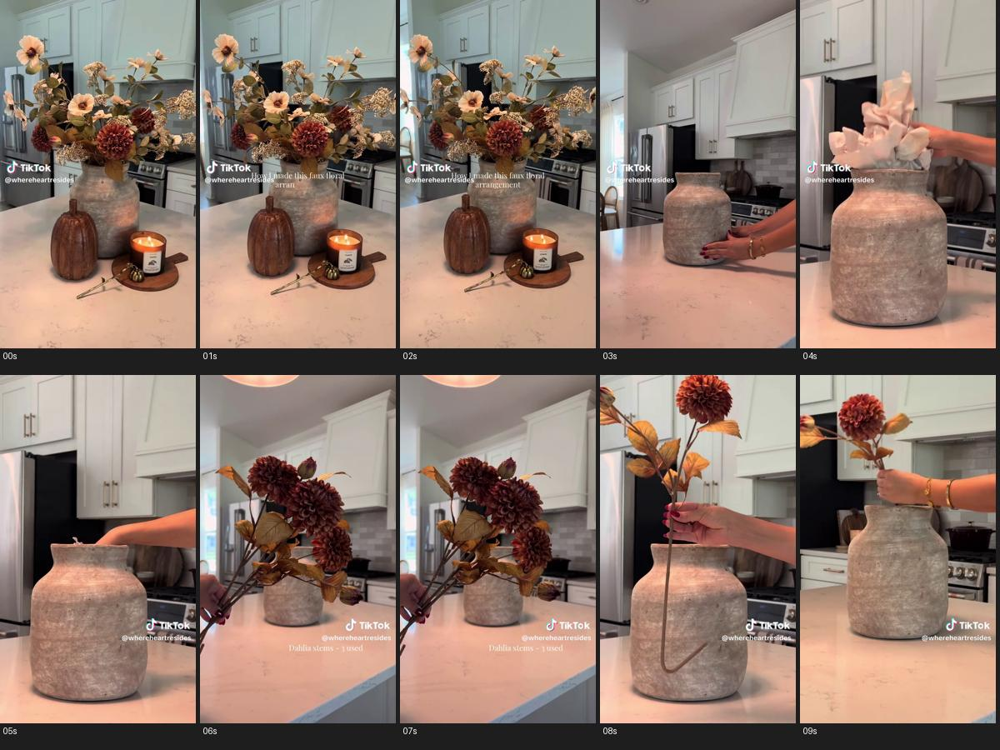
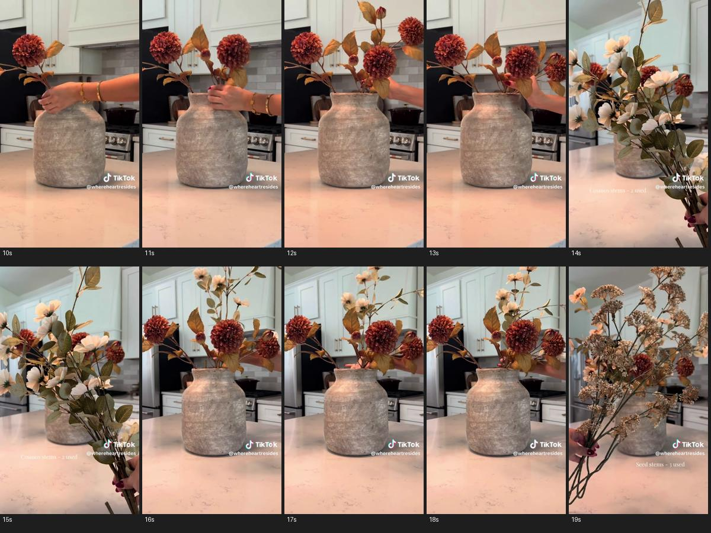
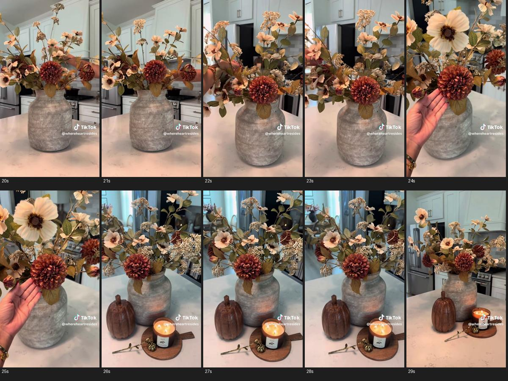

# L03：花卉分组插制与台面陈列参考

2026-10-29。用户提供TikTok链接，后提供本地Download.mp4，按同类风格参考使用，不是本SKU商品资料。在线工具先前未取得视频；本记录仅基于已解码本地文件，不声称在线成功播放。

来源：https://www.tiktok.com/@whereheartresides/video/7674285960154156319
本地源：E:/Amazon_skill/Download.mp4；用户说明该文件对应此链接，画面水印为@whereheartresides，未进行服务器原片比对。

## 实际查看与限制

视频576×1024，9:16，945帧，约29.97fps，视频流31.533秒、容器31.554秒；含AAC音轨，未听审，不判断音乐/旁白/节拍。
SHA-256：87bf5af150b217e06d5cb413b559a4163af8ed2b6f0b651d9ac55f7d8023352c。

已查看0–29秒每秒一帧共30帧，另按4fps加密0–3、3–6、8–14、16–19、20–24、24–26、26–31.5秒共106帧（覆盖末帧附近31.25秒），共136个采样图次。没有连续播放、没有逐原始帧审查；下列时段为观察窗口，精确切点、拍摄设备、灯具、真实花材成分、手法成功率与转化效果未核。抽样可观察相邻动作状态，不承诺采样间没有短动作/异常。

## 实际观察 → 可迁移方法

|约略观察窗口|实际可见|可迁移|不能直接继承|
|---|---|---|---|
|0–2.25s|先给已完成混合花束与大腹窄口灰色花器；岛台前方棕色南瓜摆件，右下烛杯/圆形带柄托板、小配件与散枝；浅柜背景有厨房结构。构图仅小幅变化|成品预告先说明结果；花束高、中、低层次和少量低位道具形成主次|不能称这里是60–90°环绕；不能把原灰瓶、花材配方、道具或标签当本SKU随货|
|2.5–5.25s|切到较低密度台面，手从侧边放稳空花器；切近后把白色团状填充物压入器内|先交代容器与操作空间；准备动作可单独成镜|材质、固定效果、适用花材未核，不推广纸团/花泥，不强制每条视频加准备镜|
|5.5–8.25s|手举一组酒红大花头与棕叶枝给镜头看，字幕写Dahlia及数量；下段枝茎有弯折外观|插入前短暂看清花材组，单枝/束的形状与动作有对应|不把字幕数量用于本SKU；弯折并非所有花材都适用，不由此证明内有铁丝或可随意折叠|
|8.5–13.75s|切回花器，手握枝茎逐次下放并调整酒红花头朝向/高低；有多次状态跳接，器内花逐步增加|主花建立体量，每个保留的插入动作要看得到手、茎与器口；重复放枝可在稳定落位后切|不是一镜连续插完，不能把剪辑跳接描述成连续操作或花枝自动增加|
|14–18.25s|展示一组浅色小花与叶，字幕标Cosmos；随后切回器口，将浅色枝放入已有主花间并调整|配花补空隙/建立高低层次，材料展示与插入配对|混合花材仅原片搭配；售卖单一花种时不默认加第二花种|
|18.5–21.75s|展示细碎浅褐分枝一组，字幕标Seed stems；随后插入更饱满花束，形成疏松伸展的上层|填充/线条材可作为可选第三角色，按空隙和轮廓安排|不强制三类花材，不复制原数量；实际插入部位有遮挡，隐藏固定结构未核|
|22–25.25s|切较近/略俯的整体，手在花束中调整；再切花头细节，掌心托在酒红花头旁/下方|完成前微调与花头细节呼应；手提供接触语境，花头/花瓣可看清|不把手掌当精确尺寸测量，不用触摸证明柔软/耐用；不是所有花材都可托压|
|25.5–31.25s|切回成品陈列，道具重新出现在花器前方；先较近视点、再较宽全貌，构图轻微变化|操作区清爽、结果区有装饰；过程回到开场结果，形成前后呼应|不能称精确环绕角度/轨迹；不是把原片直接横裁就适合16:9，也不恢复强制无人留白收尾|

重点加密依据：准备[dense-2-1](flower-arranging-20261029/dense-2-1.jpg)，插入[dense-3-1](flower-arranging-20261029/dense-3-1.jpg)/[dense-3-2](flower-arranging-20261029/dense-3-2.jpg)，调整[dense-5-1](flower-arranging-20261029/dense-5-1.jpg)，手与花头[dense-6-1](flower-arranging-20261029/dense-6-1.jpg)，陈列[dense-7-1](flower-arranging-20261029/dense-7-1.jpg)/[dense-7-2](flower-arranging-20261029/dense-7-2.jpg)。其他采样文件见同目录sampling.json。

## 我方适配：保留已确认目标

这是一条“成品→准备→分组材料/逐步插制→微调/细节→成品”的竖版案例。原片不证明前5秒60–90°环绕；我们的环绕来自用户约定。15秒不照搬31.53秒全流程，也不快放假装完成。

- 方案A（保持默认三镜）：0–5秒完整花卉环绕；5–13秒在已确认半成品中插入一两枝并微调；13–15秒完成态。说明代表性演示及起始已插枝，不称从空瓶插完。
- 可选方案B（分组材料四镜）：0–5秒环绕；5–7秒手持本SKU待插花枝短暂展示；7–13秒完成一次可见插入/微调；13–15秒完成态。2秒展示为同一15秒任务中的镜头，不是独立2秒生成任务；原入口能力待核。每镜编号独立，不把切镜叫一镜到底。
- 若用户要主花/配花/填充分组全过程，可在≤30秒内重分预算；先核本SKU配方和动作范围。动作太多时提出减步骤或长版委托，不能给15秒词塞原片十几个镜头。

## 布景与16:9适配

借方法而非强制厨房/秋季：花材高层为主、容器中层、低位配件少量点缀，色彩从商品已知色系提取；原片酒红/奶油/褐色不推广到所有花。前段展示和末段结果可有装饰，插花段把双手到器口的活动区留清；场景/相机变化只能通过明确切镜，不让道具凭空出现/消失。

默认16:9重新安排横向操作空间、花冠最高点和侧向枝条，保留产品完整与手的进入路径；不能硬裁9:16造成花头或手被截。现场光源未核，亮暗/暖冷画面只能作为效果参考。原片烛光、南瓜、厨房、电器均可不采用，不把明火、额外花器或其他花材变成固定风格。

## 写入技能与验证边界

花卉路线新增：花材组及角色、准备/插入配对、落位切镜与枝数账、布景与操作区分时状态、16:9重构、可选四镜方案。保留默认15秒/最长30秒、前5秒环绕、人物局部、弹窗确认动作范围；不重新引入首镜缓推或无人留白尾卡。

只形成观察与制作方法，没有为本SKU确认花材、填料、剪折、随货或实际安装机制；未生成任何视频，也未承诺模型能复现参考动作。独立音轨保持未听审。
