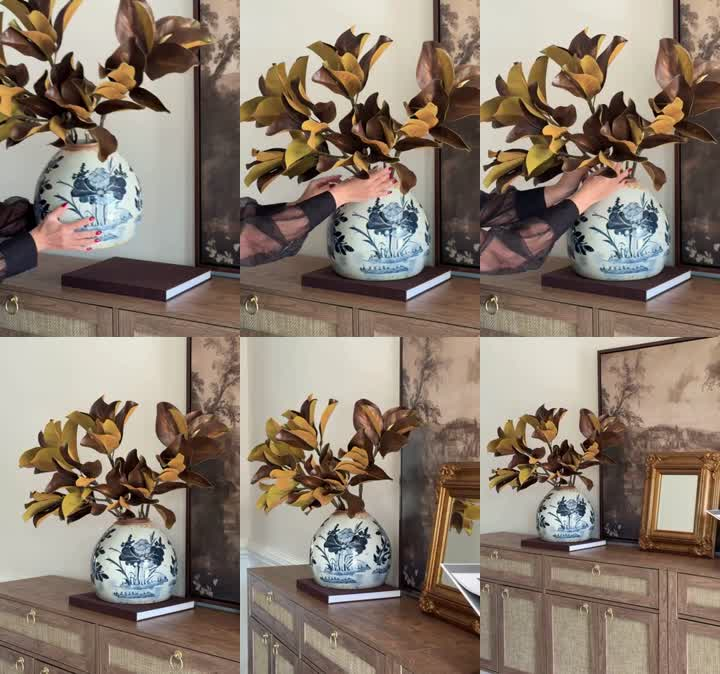

# 花卉视频路线扩展：公开来源研究（2026-10-29）

## 证据边界

本轮检索 YouTube、B站、TikTok、品牌官网及品牌创作者 brief。Afloral 一个公开产品视频完成下载与六个时间点画面采样；其他条目分别标记页面内容或检索线索，不能冒充逐帧观片。品牌案例可提供拍法，不证明本 SKU 的材质、功能、配件或亚马逊审核结果。以下建议时间预算均为适配方案，不是原视频时间码。

## E01：Afloral 成品摆位与空间效果（实际视频采样）

- [官方产品页：Brown Artificial Magnolia Leaf Branch 41](https://www.afloral.com/products/fall-brown-artificial-magnolia-leaf-branch-41)
- [官方视频 MP4](https://www.afloral.com/cdn/shop/videos/c/vp/f8510277f9394a43bbce77b1cd561bbd/f8510277f9394a43bbce77b1cd561bbd.SD-480p-1.5Mbps-92794399.mp4?v=0)
- 媒体元数据：9.75秒，30fps，342×480；有音轨，本轮未分析声音。
- 六个精确帧采样：0/2/4/6/8/9.5秒，使用帧序号0/60/120/180/240/285。临时研究文件 `/tmp/afloral-magnolia.mp4` 和 `/tmp/afloral-magnolia-exact.jpg`；这些临时文件不是技能运行依赖。

|采样点|直接可见画面|不能据此断言|
|---|---|---|
|0秒|双手捧着已经插好枝叶的青花瓶，瓶在边柜上书本上方|不是空瓶、不是从零制作|
|2秒|花瓶已经落在书本上，双手靠近瓶口及枝叶|不能由这一帧断定是否增添了花枝|
|4秒|双手仍在瓶口附近调整枝叶|不能断定隐藏茎部的连接方法|
|6秒|无人，中景呈现成品花瓶和枝叶|未逐帧检查转场边界|
|8秒|更宽视野展示花瓶、边柜与画框|稀疏帧不足以区分连续拉远与切换机位|
|9.5秒|更宽的家居全景，产品置于边柜上的书本上|未证明所有场景配件随货|

**可迁移结构：** 成品摆位→少量微调→退手后的空间效果。主角只出现手与袖子；现成花艺不必被强行拆开再插。装饰与色调围绕主体统一；可分别生成摆位、微调、宽景，明确硬切而非声称复现原片连续运镜。花枝本身属于草木邻近案例，迁移到成品花束时需保留花型、数量、瓶体和重心。

**原创15秒适配草案：** 0–4秒双手将已有成品放到固定位置；4–10秒只调整一根已存在、允许调整的枝条；10–15秒切更宽固定构图显示摆放效果。不把此预算说成原片脚本。

## E02：Ling's Moment DIY Centerpieces（官方页面，播放未核）

[官方DIY桌花页](https://www.lingsmoment.com/pages/diy-centerpieces)确实嵌入三条 YouTube 视频：

- [视频 yZeSSek0dEc](https://www.youtube.com/watch?v=yZeSSek0dEc)
- [视频 BunC3u0fwww](https://www.youtube.com/watch?v=BunC3u0fwww)
- [视频 QOumHAxylXk](https://www.youtube.com/watch?v=QOumHAxylXk)

页面介绍配色花盒、花器与教程；本轮 YouTube 抓取为 cache miss，不能给三片命名具体动作、分镜或时间码。可作为后续直接观看入口；不从页面推定“开头必环绕”。

## E03：Ling's Moment 花拱门指南（官方步骤文本）

[White & Sage Floral Arch Tutorial](https://www.lingsmoment.com/blogs/wedding-tutorials/diy-white-sage-wedding-floral-arch-tutorial-step-by-step-floral-styling-guide-1)

已读正文：先列材料，再规划轮廓与固定基础，随后用绿叶建立边界和体积，最后用花色与下垂元素完善。属于已核步骤文本，未获得对应视频逐帧证据。可借“先交代材料与支撑→关键连接动作→最终布置”，不将长教程压成15秒完整安装。固定件、花泥和绑扎方式须由本 SKU 资料另行证实。

## E04：Afloral 创作者任务书（品牌发布文字）

[Afloral Influencer Campaign](https://app.creator.space/campaign/afloral-influencer-campaign)，页面标记2026-09-29发布。

已读任务要求：在真实家居中展示商品如何搭配或使用，可围绕日常角落与季节更新；商品为视觉焦点；交付包含一条无文字、无音频视频，并避免重滤镜修改产品。其要求支持“空间搭配”作为独立内容方向，不要求先环绕再插花。品牌页面列有 Instagram 示例，但本轮未观看这些实例，不给它们写镜头拆解。

适配建议：局部空间现状→放置商品→同机位完成态。若要前后对照，保持机位、曝光与其他物品一致，不能借调色制造产品效果。

## E05：decorium 夏季花材开箱（YouTube标题与描述）

[Summer Unboxing / Artificial Flowers for Summer Arrangements / Order Presentation](https://www.youtube.com/watch?v=pjyiUpDn6jo)，检索返回作者 decorium、2019-07-06发布及标题描述。

证据仅为视频元数据，不是实际观看；能确认主题是夏季仿真花开箱/订单展示，不能确认顺序、节奏或运镜。可提出“包装/清点→单枝近景→完成态”的原创备选路线，但只有实际包装与清单齐备时才能采用。

## E06：B站超大花H款（标题/说明可检索，播放受限）

[超大花H款](https://www.bilibili.com/video/BV1xem9B1EqV/)，检索页标注2025-12-13、2分56秒；说明讨论大体积成品运输与自由搭配。

直接打开返回412，本轮没有观看画面；不是已核亚马逊案例。只列为“大型装饰花的搭配/运输说明”线索，不提取具体镜头与性能主张。

## E07：TikTok覆盖与访问限制

[Afloral官方身份页](https://www.afloral.com/pages/authenticity)列出官方 TikTok `@afloralofficial`、YouTube频道和亚马逊品牌店，可确认品牌身份与渠道对应关系。本轮未取得可核观看的 TikTok 原视频。搜索出现的二手爆款报道、播放量、耐晒不褪色口号不进入可直接复用的事实库。

## 融合判断

可直接纳入：按营销任务选择结构；成品摆位/微调路线；真实家居场景；明确脚本意图、可见证据和拍摄动作；未观看视频不能写“已核分镜”。

条件纳入：花材开箱与清点（有包装/清单）；材料→动作→结果（有真实操作依据）；局部前后变化（机位/曝光一致）；安装路线（有连接依据且预算足够）。

不纳入：他牌功能保证、推定原片时间码、无证据的销售效果、把一段15秒AI演示说成真实完整安装。当前“5秒环绕→插花→完成态”可保留为原默认，但不应阻止有依据的其他花卉路线。

## E08：GitHub工作流与官方提示词方法（文本已读）

[AI Storyboard Video Starter](https://github.com/Samin12/ai-storyboard-video-starter)使用brief、参考、逐镜起止状态与接缝检查组织产品视频。借用身份约束和状态记录；不搬入强制生成故事板/首尾帧、逐步审批、自动安装脚本和推送GitHub的流程，这些与本技能的纯规划默认不符。

[腾讯混元官方提示词手册](https://github.com/Tencent-Hunyuan/HunyuanVideo-1.5/blob/main/assets/HunyuanVideo_1_5_Prompt_Handbook_EN.md)把主体、动作、场景与运镜分开描述；本技能将方法适配为中文动作与状态句，不将模型参数移植到即梦。具体词例见[花卉提示词](../flower-prompt-patterns.md)。

## E09：亚马逊版位原则（官方文本）

[Sponsored Brands视频指南](https://advertising.amazon.com/library/guides/getting-started-with-sponsored-brands-video)建议先明确目标受众、呈现用途或变化、简洁表达，建议15–30秒并考虑静音观看。没有把“5秒环绕→插花”列为固定结构。此处是该广告类型的创意建议，不能当商品详情视频或所有入口的审核硬规范；Logo/字幕/CTA若需要，以后期文案与版位需求单独处理。

## 保存的画面证据

仅研究参考，不作为本SKU生成身份图或可直接发布的广告素材。其余F02/F04/F05/F06是结合资料提出的结构设计，不能声称本轮均有实看视频验证。
