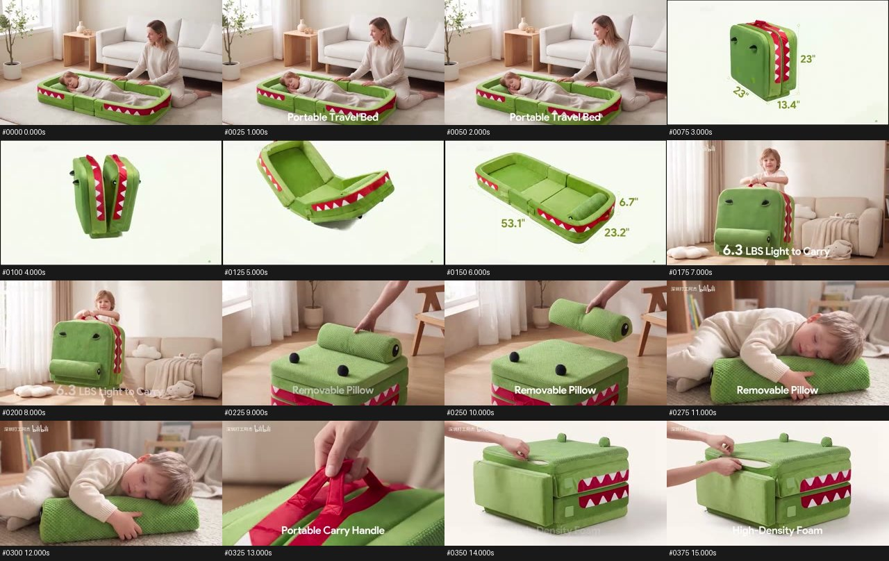
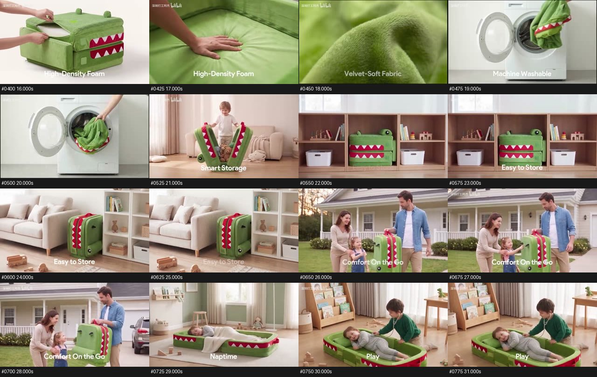
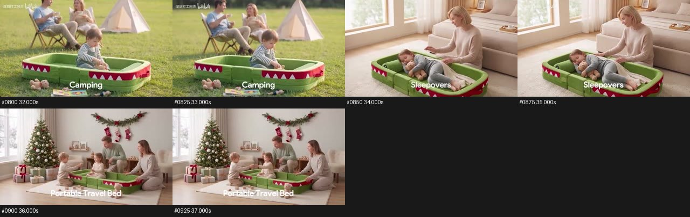
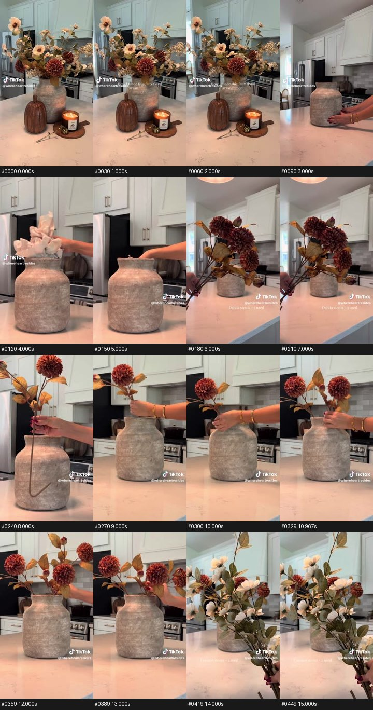
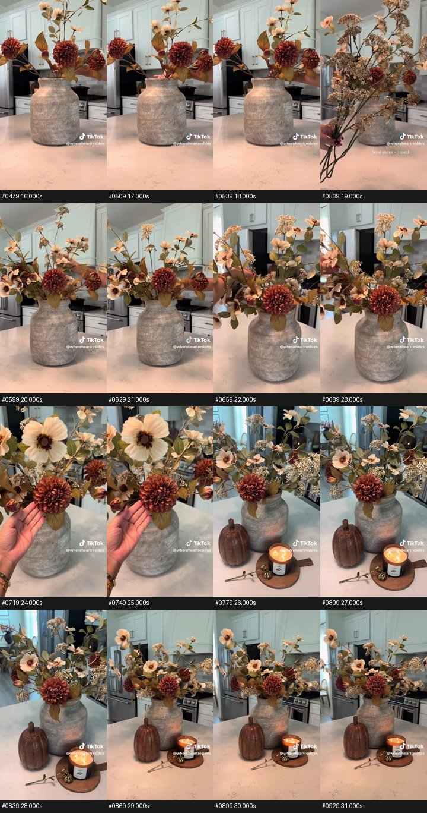

# 双参考视频：逐帧序列审阅与花卉模板提取

日期：2026-10-31。用途：重设计 amazon-video-generation，先完成花卉路线。

## 来源与审阅范围

- A：[B站 BV1aGaq6rErq](https://www.bilibili.com/video/BV1aGaq6rErq/)，作者深圳打工阿杰。使用此前公开接口下载的媒体缓存，SHA-256 与旧研究记录一致：`c12019d44c97b543ab10d4685cc75d03b155c7a50ec97cbb45fdb5f38a45c7e0`。本次网页访问失败，没有因此假称重新下载了高清片。实际媒体640×360、25fps，949帧，视频时间轴0–37.96秒左右；容器含音轨约37.97秒。标题中的制作模型是作者声明，无法从成片反推真实工作流。
- B：`Download.mp4`（用户工作区本地原片），576×1024，约29.97fps，945帧，末帧PTS 31.500秒，容器约31.55秒。画面水印为 `@whereheartresides`，片中展示混合花材布置。
- 两片均用FFmpeg逐帧解码，保留原帧序与PTS；分别查看全部20张连续帧联系表，总计1,894帧。每张48帧，末页不足48帧。不是1fps采样冒充逐帧；查看形式是缩略连续帧序列，不是逐张全分辨率放大质检。A单格320×180，B单格180×320，工具显示还可能缩放整板，因此不能据此排除细微手指/纹理瑕疵。
- 本次未听审音轨，不推断配乐节拍、旁白内容或音画同步。以下切点依据可见帧序，精度受源帧率限制。未验证销售转化效果。
- 工作区研究包中的 `bilibili/frames.json` 与 `download/frames.json` 记录逐帧PTS、帧数和源哈希；其中单帧路径为临时工作文件。持久审阅证据为各目录的 `all-01.jpg` 至 `all-20.jpg` 和总览图。

## A：功能与生活用途串联

以下时间区间左闭右开，镜头结束取下一镜首帧。尺寸读数和英文主张只是参考片内容，不是本项目商品事实。

|首帧—末帧|时间（秒）|画面与运动|剪辑作用|花卉可迁移方式|
|---|---|---|---|---|
|0–71|0–2.880|母亲与孩子、已展开鳄鱼造型床，轻微视点变化|先建立用途与亲密生活语境|先展示花卉在空间中的完整成品；可改为短弧环绕|
|72–161|2.880–6.480|浅底孤立产品：折叠态尺寸→悬空展开并改变朝向→展开态尺寸|状态变化解释收纳体积与使用占地|整体空间尺度、分组陈列或真实可调整状态，三者分别规划|
|162–204|6.480–8.200|孩子握提手提起折叠产品|把轻便主张连接到动作|手持花枝展示尺度；不能单靠动作证明重量数值|
|205–258|8.200–10.360|手进入、接触圆柱枕、提离|交代部件与可拆动作|仅迁移到本SKU真实可拆部件；普通花束可用取枝/落位|
|259–306|10.360–12.280|孩子抱靠枕部|紧接部件动作，展示用途结果|插入后立即显示该枝对整体层次的贡献|
|307|12.280–12.320|床垫手掌画面短暂闪现一帧|孤立过渡帧，可能是剪辑残留，原因未证实|不写入模板；交付验片要检查单帧闪切|
|308–345|12.320–13.840|手提把手近景|解释具体接触位置|茎秆抓握、花瓣/叶片触碰近景，避免无意义重复|
|346–402|13.840–16.120|浅底折叠产品，双手拉开表层，露出白色内层|外观进入结构|花卉仅展示已知结构；不能自造金属丝/内部剖面|
|403–443|16.120–17.760|手掌按床垫表面，见凹陷|结构之后跟使用反馈|若已确认柔韧，可拍轻扶调整；不能迁移成“回弹性能证明”|
|444–467|17.760–18.720|绿绒表面近景|短材质信息插镜|花瓣边缘、纹理、叶面色阶的真实可见细节|
|468–500|18.720–20.040|布套状物靠近并放入洗衣机|维护方式|只能迁移镜头语法，不把可机洗套给花卉|
|501–546|20.040–21.880|孩子拉开折叠产品，内部露出玩具|动作说明附加用途|套装构成展示，但保持真实售卖组成|
|547–589|21.880–23.600|柜格中收纳状态|结果与空间关系|花卉在玄关/边柜的摆放尺度|
|590–630|23.600–25.240|沙发与柜旁立放|补第二种空间适配|同SKU另一位置，信息要有新增|
|631–711|25.240–28.480|屋外家庭，成人提产品，车辆在背景|把功能连接到出行情境|只继承用途拓展，不能借此暗示花卉耐候|
|712–738|28.480–29.560|卧室午睡|用途蒙太奇1|安静卧室装饰|
|739–785|29.560–31.440|儿童房玩耍|用途蒙太奇2|日常客厅/家庭活动空间|
|786–839|31.440–33.600|草地露营|用途蒙太奇3|有依据的餐桌、聚会或活动布置|
|840–885|33.600–35.440|母亲陪孩子休息，窗边客厅|用途蒙太奇4|不同布置任务，维持商品身份|
|886–948|35.440–约37.960|节日家庭场景、产品名|回到生活价值并收束|最终花卉主视觉，可呼应开头|

### 空间展开段的真实节奏

帧72起先停在折叠状态；帧98（3.920秒）附近标注退去、主体上移，随后张开；帧110–125（4.400–5.000秒）形态展开并改变朝向；帧126–132（5.040–5.280秒）趋于完整展开；帧133（5.320秒）起出现展开态尺寸，稳定保持至6.440秒。

可复用的是“可读起态→过渡→可读终态”，而不是一边高速旋转一边让数字不停追随。它是呈现三维空间感的渲染式动画；仅凭成片无法确认制作时是否用了真正3D建模，也不能证明物理展开结构准确。花卉的相机环绕与物体自转应作为两个不同动作说明。

## B：花材展示与使用动作配对

|首帧—末帧|时间（秒，PTS近似）|观察|可复用决策|
|---|---|---|---|
|0–71|0–2.400|完成花艺、花瓶、南瓜与蜡烛，轻微手持视点变化|结果先行，先让人理解装饰效果|
|72–107|2.400–3.600|双手将空花瓶摆在台面|明确回到布置起态；这是剪辑回溯|
|108–164|3.600–5.500|纸状填料放入花瓶、向下按入|有具体支撑方法，但不自动迁移到别的SKU|
|165–210|5.500–7.033|手持暗红色花材组，花瓶在后方|先辨认即将使用的材料组|
|211–253|7.033–8.467|单枝正面展示，茎下部有弯折，花瓶作背景|单枝结构与长度关系；不是尺寸实测|
|254–298|8.467–9.967|花枝自上方插入，手降低至瓶口，落位后放松|保留接近、插入、定位的可读过程|
|299–341|9.967–11.433|切入下一枝的插入动作|在前一枝落位后跳切，省略取下一枝的空时间|
|342–412|11.433–13.800|后续暗红花枝插入、调整前景与左右层次|同场景机位/花瓶连续，花材按操作逐步增加|
|413–474|13.800–15.867|浅色花材组在前景，已有暗红成品在后方|重复“材料组→布置”语法，颜色层次变化有信息|
|475–548|15.867–18.333|浅色花枝进入既有布置并调整|在已完成状态上递进，不从空瓶重来|
|549–596|18.333–19.933|细枝填充花材组展示|解释下一层轮廓与空隙填充|
|597–653|19.933–21.833|较完整花艺、局部调整与手部活动|展示新增层次与结果；不能断言每枝插入均被完整拍到|
|654–699|21.833–23.367|较高视角靠近成品，前景有手部整理|从操作转向欣赏，景别变化承担转折|
|700–760|23.367–25.400|手托/轻触暗红花头，浅色花朵在旁|手作为接触与尺度语境；不自动证明材质“真触感”|
|761–846|25.400–28.267|成品与南瓜、蜡烛同框，视点缓移|补足整体布置与空间关系|
|847–944|28.267–约31.533|回到接近开头的正面成品构图，视点微移|首尾呼应，形成视觉闭环|

这段片是在同一厨房、同一花器上的分段布置记录，未观察到多房间变场或完整360°环绕。不能把这些未出现的内容写成参考片事实。新增环绕、尺寸与跨场景属于本次用户要求的模板扩展。

## 提取的通用流程

共同语法：结果/用途先行 → 明确一个信息问题 → 用可见细节或动作回答 → 给动作结果停留 → 扩展使用语境 → 成品收束。

花卉综合模板（用户本轮已选，以下是新设计，不是原片复刻）：

|模块|30秒示例|画面任务|所需输入|
|---|---|---|---|
|整体环绕|0–4s|建立花型、体量与场景|最终清楚成品图、可用侧面|
|空间尺寸|4–8s|说明单枝或成品高宽，先动后停留读数|核实尺寸与测量端点；干净产品图|
|卖点细节1–2项|8–13s|可见花瓣/叶片/枝条特征|对应细节图与已确认事实|
|使用展示|13–20s|代表性插入、整理或摆放，给结果|已确认操作方式、动作起止参考|
|多场景|20–27s|2–3个不同空间用途，匹配构图与运动|已定场景图、同SKU一致状态|
|成品收尾|27–30s|呼应开头，停留识别|最终成品主视觉|

25秒可用4+4+4+6+5+2；15秒简版可用3+2+3+4+3，将多场景段的最后一个成品画面作为收尾，只保留一个主要卖点。若同时要求多次插入、三个场景、复杂空间展开，优先25–30秒，不能用加速把所有动作塞入15秒。

三种空间模块：D1完整形态旋转＋尺寸线展开；D2售卖花枝/套装分组悬浮陈列后归位；D3有事实依据的可调整结构动作。D2是视觉陈列动画，不能暗示固定花头可拆、花朵自动生长、成品能自动装配。复杂D2不同时叠加大幅运镜、尺寸数字和多人操作。

整体主提示词与视觉分镜板共同负责时间顺序；精选商品图负责身份与细节。分镜板上传为叙事参考，不默认设置为视频首帧。成片目标为逐镜全屏画面，不是宫格同时动。

## 平台能力记录

2026-10-31查阅[火山引擎智能视频官方文档](https://docs.volcengine.com/docs/large-model-of-image-generation/smart-video?lang=zh)，页面说明Seedance 2.5单片段可至30秒。此证据针对该平台文档，不等于用户即梦入口已开放相同能力。新版应记录实际模型、模式、时长上限和参考槽位，优先整片，时长不足再拆前后两段。不能从参考片标题推断生成任务数或准确模型版本。

## 随技能保留的证据图

下列图覆盖全片总览，逐帧联系表在本轮工作区研究包中：

[空间展开连续48帧](two-reference-20261031/bilibili-unfold-frames.jpg)。
